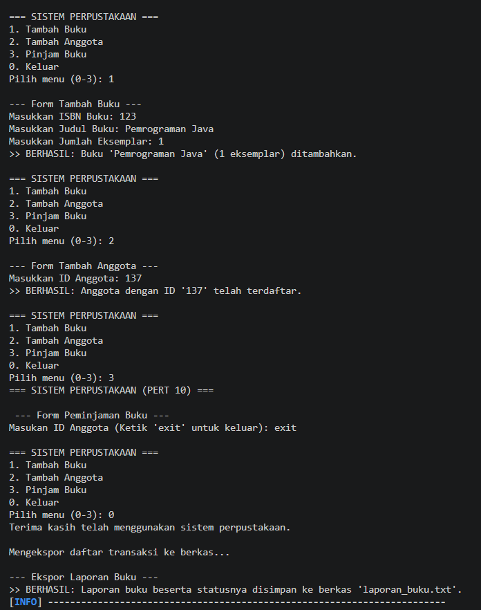
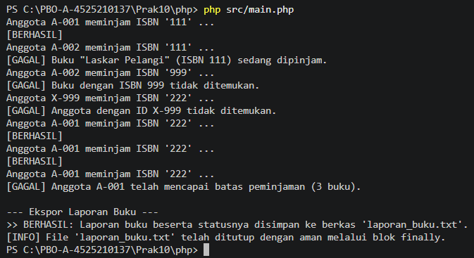

# LAPORAN PRAKTIKUM PEMROGRAMAN BERBASIS OBJEK

| Informasi Praktikan | Keterangan |
| :--- | :--- |
| **Nama** | Arkaan Abdul Hafizh |
| **NPM** | 4525210137 |
| **Kelas** | A |
| **Mata Kuliah** | Pemrograman Berbasis Objek (PBO) |
| **Pertemuan** | 10 - Exception Handling dan Pemrograman Defensif |
| **Tanggal** | 07-11-2026 |

---

## 1. Deskripsi Proyek

Proyek ini adalah aplikasi **Sistem Perpustakaan** sederhana yang diimplementasikan dalam dua bahasa, yaitu **Java** dan **PHP**. Fokus praktikum adalah penerapan *exception handling* dan pemrograman defensif, yaitu:

- Membuat hierarki *custom exception* untuk kesalahan pada domain perpustakaan.
- Memisahkan data (`model`), logika bisnis (`service`), dan program utama.
- Menggunakan `try-catch-finally` agar program tidak berhenti mendadak dan sumber daya (berkas) selalu ditutup dengan aman.
- Menyediakan skenario uji untuk memicu setiap exception (lihat `java/skenario-uji.md`).

Aturan bisnis yang diterapkan:

1. Buku dan anggota harus terdaftar sebelum dapat dipakai pada transaksi peminjaman.
2. Buku yang sedang dipinjam tidak dapat dipinjam lagi.
3. Satu anggota dibatasi maksimal **3 buku**.
4. Laporan daftar buku (beserta status ketersediaan) dapat diekspor ke berkas `laporan_buku.txt`.

---

## 2. Struktur Folder

```
Prak10/
|-- images/
|   |-- RunJava.png
|   |-- RunPhp.png
|
|-- java/
|   |-- pom.xml
|   |-- skenario-uji.md
|   |-- struktur.txt
|   |-- laporan_buku.txt
|   |-- src/main/java/id/ac/univpancasila/perpustakaan/
|       |-- exception/
|       |   |-- PerpustakaanException.java
|       |   |-- AnggotaTidakDitemukanException.java
|       |   |-- BatasPinjamTerlampauiException.java
|       |   |-- BukuSedangDipinjamException.java
|       |   |-- BukuTidakDitemukanException.java
|       |-- model/
|       |   |-- Anggota.java
|       |   |-- Buku.java
|       |-- service/
|       |   |-- LibraryService.java
|       |   |-- LibraryServiceKotor.java
|       |   |-- PerpustakaanService.java
|       |-- util/
|           |-- Main.java
|
|-- php/
|   |-- composer.json
|   |-- composer.lock
|   |-- src/
|       |-- exception/
|       |   |-- PerpustakaanException.php
|       |   |-- AnggotaTidakDitemukanException.php
|       |   |-- BatasPinjamTerlampauiException.php
|       |   |-- BukuSedangDipinjamException.php
|       |   |-- BukuTidakDitemukanException.php
|       |-- model/
|       |   |-- Anggota.php
|       |   |-- Buku.php
|       |-- services/
|       |   |-- LibraryService.php
|       |   |-- LibraryServiceKotor.php
|       |-- test/
|       |   |-- LibraryServiceTest.php
|       |-- util/
|       |   |-- laporan_buku.php
|       |-- vendor/
|           |-- main.php
|           |-- laporan_buku.txt
|
|-- README.md
```

> Folder `target/` (Java) dan `vendor/` di dalam `php/` (hasil `composer install`) dibuat otomatis dan tidak disertakan di repository. Folder `src/vendor/` pada PHP berbeda dengan folder tersebut karena berisi `main.php` dan `laporan_buku.txt`, sehingga tetap disertakan.

---

## 3. Implementasi Java

### 3.1. Package `exception`

| File | Penjelasan |
| :--- | :--- |
| `PerpustakaanException.java` | Kelas dasar (induk) seluruh exception pada aplikasi perpustakaan. Dengan induk bersama, semua kesalahan domain dapat ditangkap sekaligus lewat satu blok `catch`. |
| `BukuTidakDitemukanException.java` | Dilempar ketika ISBN yang dicari tidak terdaftar. |
| `AnggotaTidakDitemukanException.java` | Dilempar ketika ID anggota belum terdaftar. |
| `BukuSedangDipinjamException.java` | Dilempar ketika buku yang diminta sedang dipinjam anggota lain. |
| `BatasPinjamTerlampauiException.java` | Dilempar ketika anggota sudah mencapai batas maksimal 3 buku. |

### 3.2. Package `model`

| File | Penjelasan |
| :--- | :--- |
| `Buku.java` | Kelas data buku: ISBN, judul, jumlah eksemplar, dan status dipinjam. |
| `Anggota.java` | Kelas data anggota: ID, nama, daftar ISBN yang sedang dipinjam, dan konstanta `BATAS_PINJAM = 3`. |

### 3.3. Package `service`

| File | Penjelasan |
| :--- | :--- |
| `LibraryServiceKotor.java` | Versi awal sebelum *refactoring*, penanganan kesalahan masih belum rapi. Disimpan sebagai pembanding. |
| `LibraryService.java` | Versi hasil *refactoring* yang melempar *custom exception* sesuai jenis kesalahan. |
| `PerpustakaanService.java` | Kontrak/abstraksi layanan perpustakaan yang menjadi acuan implementasi service. |

### 3.4. Package `util`

`Main.java` adalah program utama berbasis menu interaktif:

```
=== SISTEM PERPUSTAKAAN ===
1. Tambah Buku
2. Tambah Anggota
3. Pinjam Buku
0. Keluar
```

Setiap kesalahan input atau aturan bisnis ditangkap dengan `try-catch` sehingga program tidak berhenti dan pesan kesalahan ditampilkan ke pengguna.

### 3.5. Cara Menjalankan

Dari folder `java`:

```bash
mvn clean compile
java -cp target/classes id.ac.univpancasila.perpustakaan.util.Main
```

Alternatif dengan Maven (mainClass sudah diatur di `pom.xml`):

```bash
mvn compile exec:java
```

---

## 4. Implementasi PHP

### 4.1. Autoload dan Namespace

PHP memakai *autoload* Composer dengan standar PSR-4 (`composer.json`):

| Namespace | Folder |
| :--- | :--- |
| `Perpustakaan\` | `src/` |
| `Perpustakaan\Exception\` | `src/exception/` |
| `Perpustakaan\Model\` | `src/model/` |
| `Perpustakaan\Service\` | `src/services/` |

### 4.2. Komponen

| Berkas | Penjelasan |
| :--- | :--- |
| `src/exception/*.php` | Padanan lima kelas exception pada versi Java. |
| `src/model/Buku.php`, `src/model/Anggota.php` | Kelas data buku dan anggota. |
| `src/services/LibraryServiceKotor.php` | Versi awal sebelum *refactoring*. |
| `src/services/LibraryService.php` | Versi *refactoring* yang melempar *custom exception*. |
| `src/test/LibraryServiceTest.php` | Berkas pengujian layanan. |
| `src/util/laporan_buku.php` | Berkas pendukung pembuatan laporan buku. |
| `src/vendor/main.php` | Demo peminjaman buku (7 percobaan) dan ekspor laporan ke `laporan_buku.txt`. |

Pada `main.php`, ekspor laporan memakai `try-catch-finally`. Blok `finally` memastikan berkas selalu ditutup (`fclose`), baik proses berhasil maupun gagal.

### 4.3. Cara Menjalankan

Dari folder `php`:

```bash
composer install
composer dump-autoload
php src/vendor/main.php
```

---

## 5. Skenario Pengujian

Skenario berikut dijalankan pada `main.php` (PHP) dan menghasilkan perilaku yang sama dengan versi Java:

| No | Anggota | ISBN | Hasil | Exception |
| :-: | :--- | :--- | :--- | :--- |
| 1 | A-001 | 111 | Berhasil | - |
| 2 | A-002 | 111 | Gagal, buku sedang dipinjam | `BukuSedangDipinjamException` |
| 3 | A-002 | 999 | Gagal, buku tidak ditemukan | `BukuTidakDitemukanException` |
| 4 | X-999 | 222 | Gagal, anggota tidak ditemukan | `AnggotaTidakDitemukanException` |
| 5 | A-001 | 222 | Berhasil | - |
| 6 | A-001 | 222 | Berhasil | - |
| 7 | A-001 | 222 | Gagal, batas 3 buku tercapai | `BatasPinjamTerlampauiException` |

---

## 6. Hasil Eksekusi Program

Berikut hasil eksekusi program di terminal untuk masing-masing bahasa.

### 6.1. Java

<p align="center">
  
</p>

### 6.2. PHP (`php src/vendor/main.php`)

<p align="center">
  
</p>

---

## 7. Kesimpulan

Pada praktikum ini dipelajari konsep penting *exception handling* dan pemrograman defensif:

1. **Custom Exception**: Kesalahan domain dibuat sebagai kelas tersendiri dengan satu induk bersama (`PerpustakaanException`), sehingga penanganannya spesifik dan terstruktur.
2. **try-catch-finally**: Kesalahan ditangani tanpa menghentikan program, dan blok `finally` menjamin sumber daya seperti berkas selalu ditutup.
3. **Pemisahan Tanggung Jawab**: Pembagian `exception`, `model`, `service`, dan program utama membuat kode lebih mudah dibaca, diuji, dan dipelihara.
4. **Refactoring**: Perbandingan `LibraryServiceKotor` dengan `LibraryService` menunjukkan bahwa penanganan kesalahan berbasis exception lebih bersih dibanding pengecekan manual.
5. **Konsistensi Lintas Bahasa**: Java dan PHP memakai rancangan yang sama sehingga hasil skenario uji setara.