# LAPORAN PRAKTIKUM PEMROGRAMAN BERBASIS OBJEK

| Informasi Praktikan | Keterangan |
| :--- | :--- |
| **Nama** | Arkaan Abdul Hafizh |
| **NPM** | 4525210137 |
| **Kelas** | A |
| **Mata Kuliah** | Pemrograman Berbasis Objek (PBO) |
| **Pertemuan** | 7 - Pemodelan-Relasi-Objek-dan-Uml |
| **Tanggal** | 15-10-2026 |

---

## 1. Implementasi Java

### 1.1. File: `Buku.java`
**Penjelasan Kode:**

`Buku` adalah kelas turunan `Koleksi` yang merepresentasikan buku di perpustakaan. Di dalamnya terdapat kelas dalam `Bab` yang menunjukkan relasi *composition*: bab tidak dapat berdiri sendiri tanpa buku yang memilikinya.

**Bukti Eksekusi (Screenshot):**

<table>
  <tr>
    <th align="center">Before (Kondisi awal / Kesalahan kompilasi)</th>
    <th align="center">After (Kondisi akhir / Eksekusi berhasil)</th>
  </tr>
  <tr>
    <td>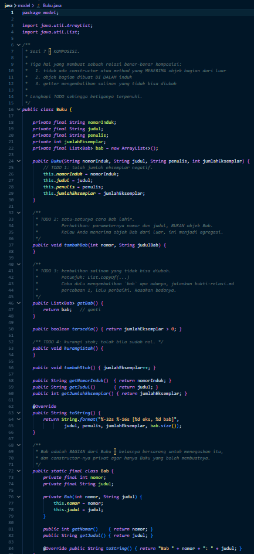</td>
    <td>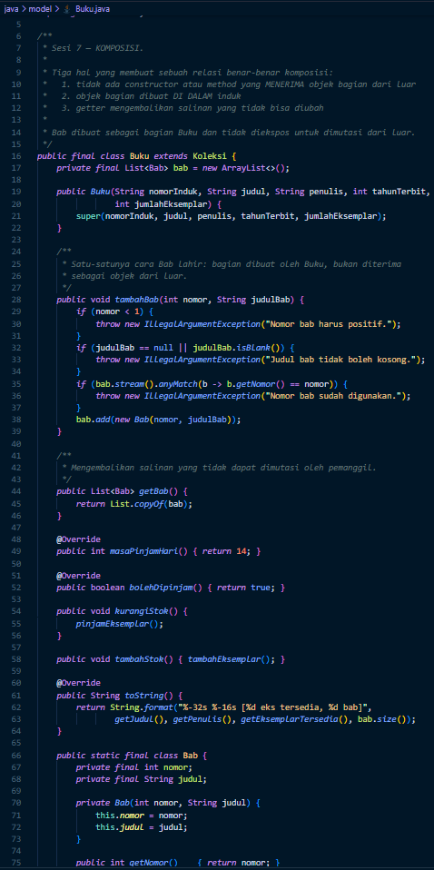</td>
  </tr>
</table>

---

### 1.2. File: `Jurusan.java`
**Penjelasan Kode:**

`Jurusan` merepresentasikan jurusan yang memiliki kumpulan `Mahasiswa` (kelas dalam). Relasi ini menggambarkan keterikatan *whole-part* antara jurusan dan mahasiswanya.

**Bukti Eksekusi (Screenshot):**

<table>
  <tr>
    <th align="center">Before (Kondisi awal / Kesalahan kompilasi)</th>
    <th align="center">After (Kondisi akhir / Eksekusi berhasil)</th>
  </tr>
  <tr>
    <td>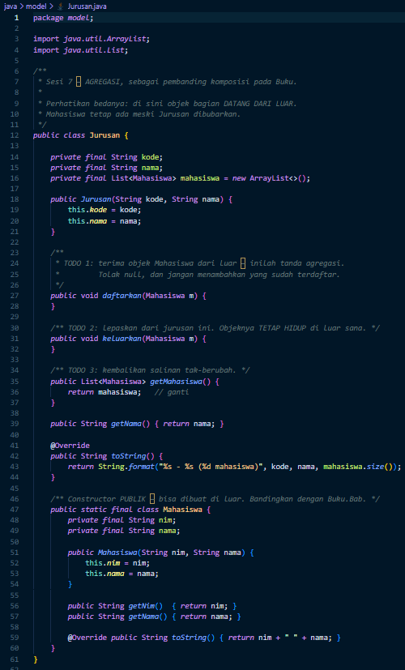</td>
    <td>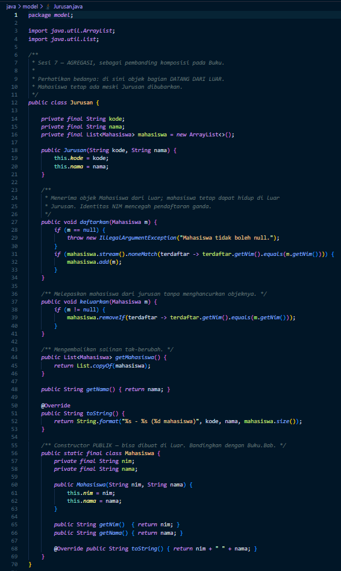</td>
  </tr>
</table>

---

### 1.3. File: `PerpustakaanService.java`
**Penjelasan Kode:**

`PerpustakaanService` adalah kelas layanan yang mengelola logika perpustakaan, seperti mendaftarkan koleksi dan anggota serta memproses peminjaman. Kelas ini bergantung (*dependency*) pada kelas-kelas di package `model` dan diuji melalui `PerpustakaanServiceTest.java`.

**Bukti Eksekusi (Screenshot):**

<table>
  <tr>
    <th align="center">Before (Kondisi awal / Kesalahan kompilasi)</th>
    <th align="center">After (Kondisi akhir / Eksekusi berhasil)</th>
  </tr>
  <tr>
    <td align="center" valign="top">
      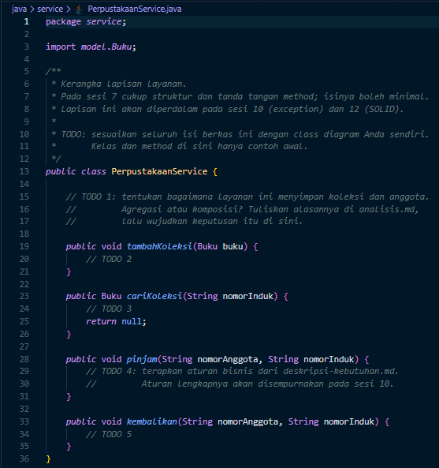
    </td>
    <td align="center">
      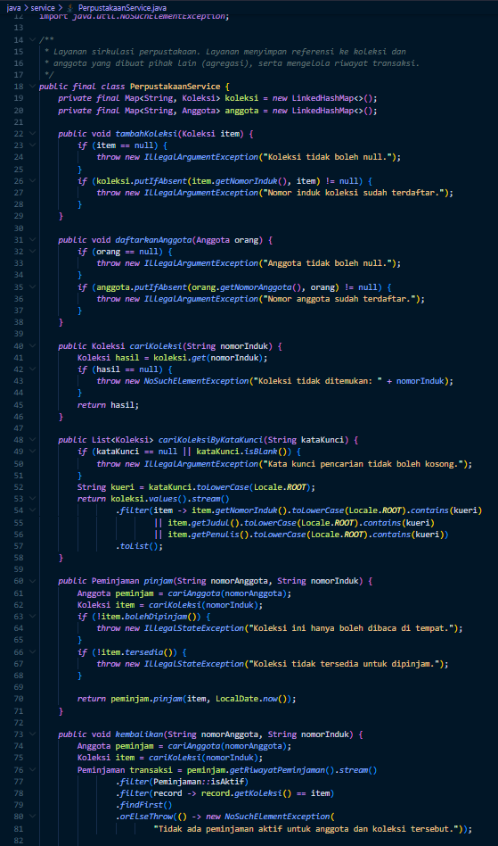  
      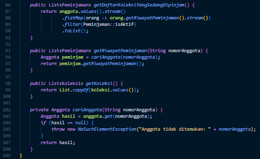
    </td>
  </tr>
</table>

---

### 1.4. File: `Main.java`
**Penjelasan Kode:**

`Main` adalah program utama yang membuat objek-objek model (`Anggota`, `Buku`, `Majalah`, `Skripsi`, `Jurusan`, `Peminjaman`) lalu memanggil `PerpustakaanService` untuk menguji relasi antar objek.

**Bukti Eksekusi (Screenshot):**

<table>
  <tr>
    <th align="center">Before (Kondisi awal / Kesalahan kompilasi)</th>
    <th align="center">After (Kondisi akhir / Eksekusi berhasil)</th>
  </tr>
  <tr>
    <td>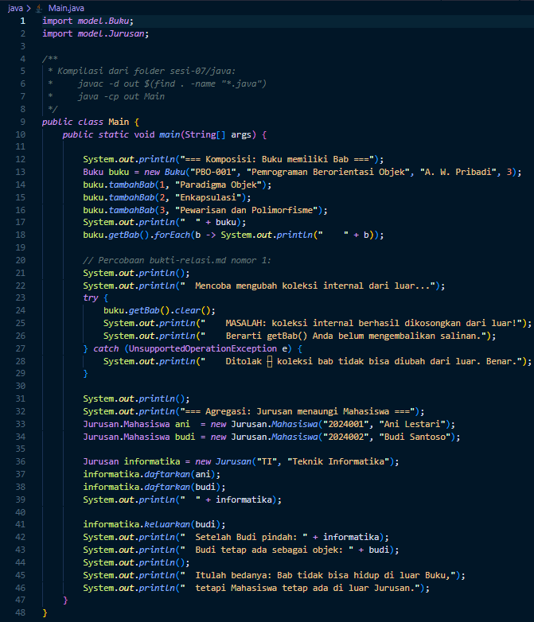</td>
    <td>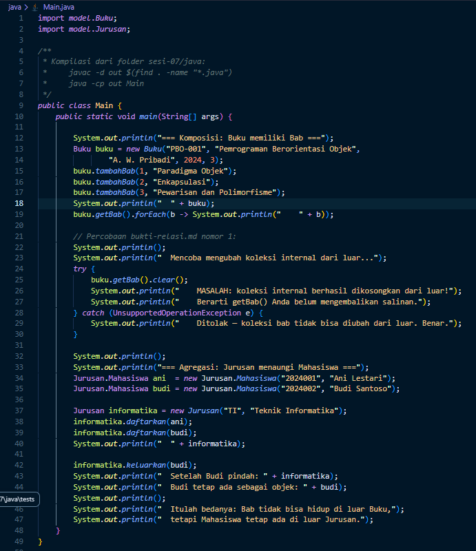</td>
  </tr>
</table>

---

## 2. Implementasi PHP

### 2.1. File: `main.php`
**Penjelasan Kode:**

`main.php` memuat kelas-kelas dari folder `src`, membuat objek, dan menjalankan skenario perpustakaan untuk memperlihatkan relasi antar objek di PHP.

**Bukti Eksekusi (Screenshot):**

<table>
  <tr>
    <th align="center">Before (Kondisi awal / Galat logika)</th>
    <th align="center">After (Kondisi akhir / Eksekusi berhasil)</th>
  </tr>
  <tr>
    <td>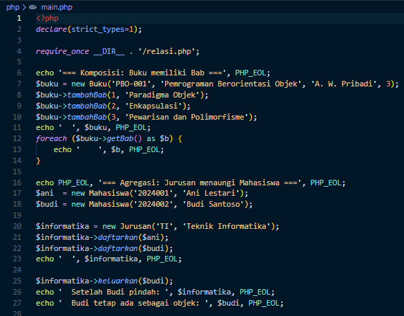</td>
    <td>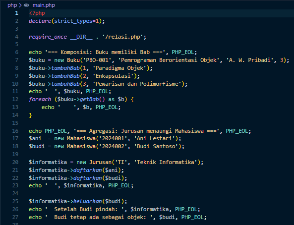</td>
  </tr>
</table>

---

### 2.2. File: `relasi.php`
**Penjelasan Kode:**

`relasi.php` digunakan untuk membuktikan relasi antar objek pada PHP (*association*, *aggregation*, dan *composition*) beserta hasil pengecekannya.

**Bukti Eksekusi (Screenshot):**

<table>
  <tr>
    <th align="center">Before (Kondisi awal / Galat logika)</th>
    <th align="center">After (Kondisi akhir / Eksekusi berhasil)</th>
  </tr>
  <tr>
    <td align="center" valign="top">
      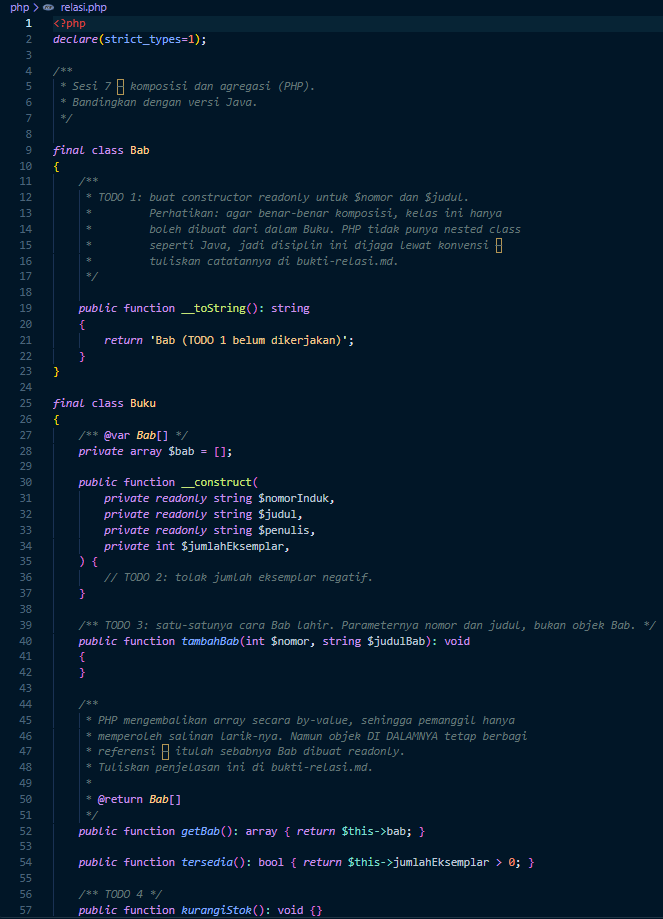  
      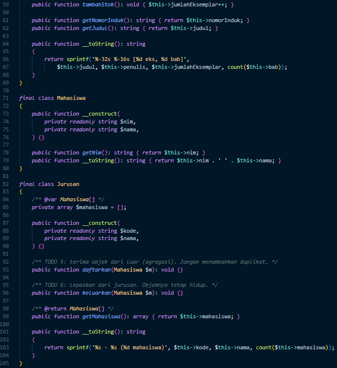
    </td>
    <td align="center" valign="top">
      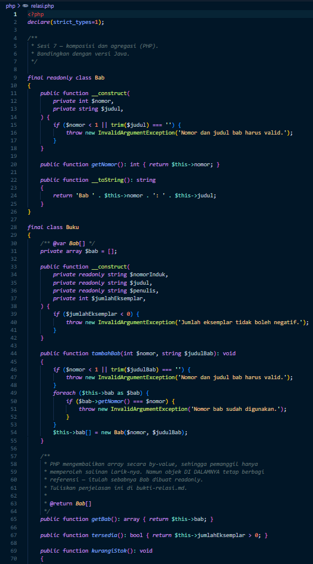  
      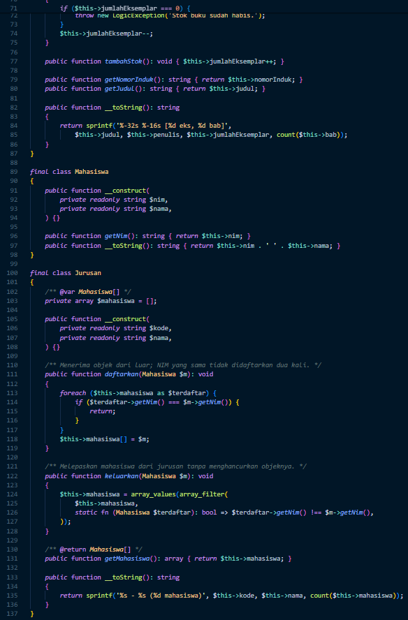
    </td>
  </tr>
</table>

---

## 3. Pemodelan UML

### 3.1. File: `perpustakaan-kerangka.puml`
**Penjelasan:**

Diagram kelas perpustakaan dibuat dengan PlantUML. Diagram ini menggambarkan kelas `Anggota`, `Koleksi` (beserta turunan `Buku`, `Majalah`, `Skripsi`), `Peminjaman`, `Jurusan`, serta enum `JenisKeanggotaan` dan `StatusKoleksi`, lengkap dengan relasi antar kelasnya.

**Bukti Eksekusi (Screenshot):**

<table>
  <tr>
    <th align="center">Before (Kerangka awal)</th>
    <th align="center">After (Kerangka akhir)</th>
  </tr>
  <tr>
    <td align="center" valign="top">
      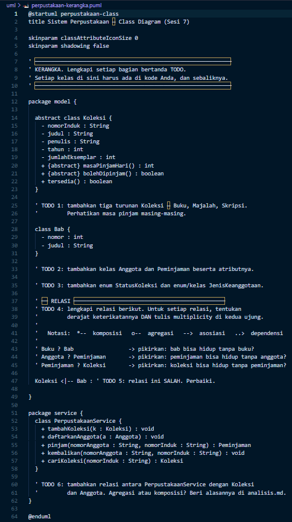
    </td>
    <td align="center">
      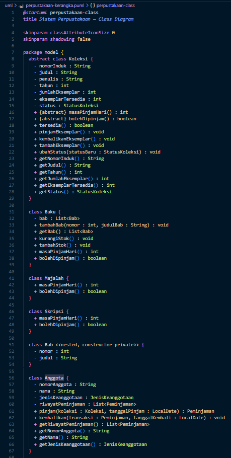  
      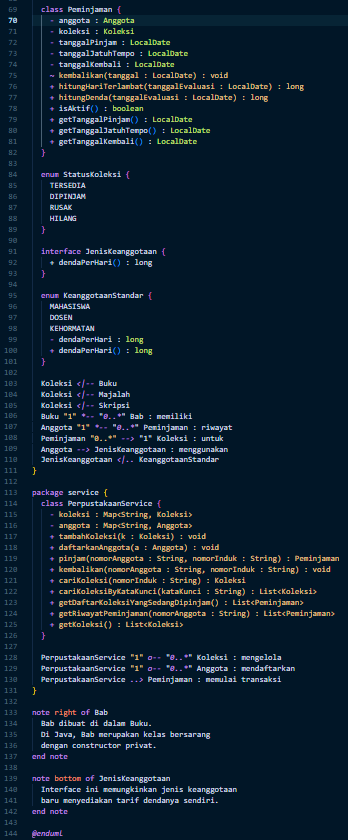
    </td>
  </tr>
</table>

**Hasil Render Diagram Kelas:**

  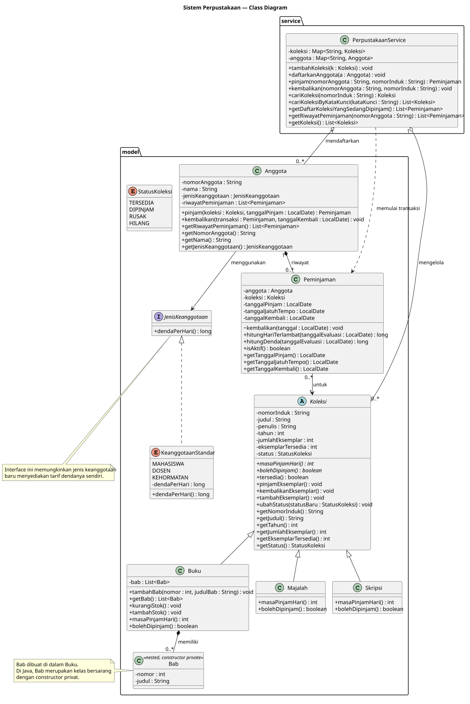

---

## 4. Hasil Eksekusi Program

Berikut hasil eksekusi program di terminal untuk masing-masing bahasa.

### 4.1. Java (`java Main`)

  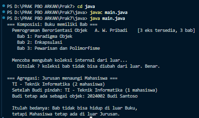

### 4.2. PHP (`php main.php`)

  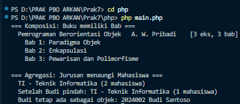

---

## 5. Dokumen Pendukung

- [Deskripsi Kebutuhan](deskripsi-kebutuhan.md)
- [Analisis](analisis.md)
- [Bukti Relasi](bukti-relasi.md)

---

## 6. Kesimpulan

Pada praktikum ini, dipelajari pemodelan relasi antar objek dan penggambarannya dengan UML:
1. **Inheritance (Pewarisan)**: `Buku`, `Majalah`, dan `Skripsi` mewarisi sifat umum dari `Koleksi`.
2. **Association**: `Peminjaman` menghubungkan `Anggota` dengan `Koleksi` yang dipinjam.
3. **Aggregation**: Hubungan *whole-part* di mana bagian dapat berdiri sendiri, misalnya perpustakaan dengan kumpulan koleksinya.
4. **Composition**: Bagian tidak dapat hidup tanpa pemiliknya, misalnya `Bab` terhadap `Buku`.
5. **Enum**: `JenisKeanggotaan` dan `StatusKoleksi` menjaga *type safety* untuk nilai yang tetap.
6. **UML (PlantUML)**: Diagram kelas membantu memvisualisasikan struktur dan relasi sebelum dan sesudah kode diperbaiki.