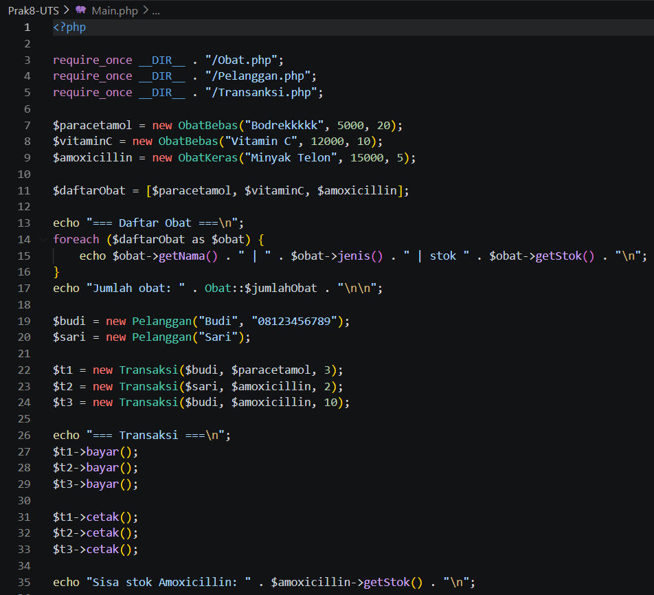
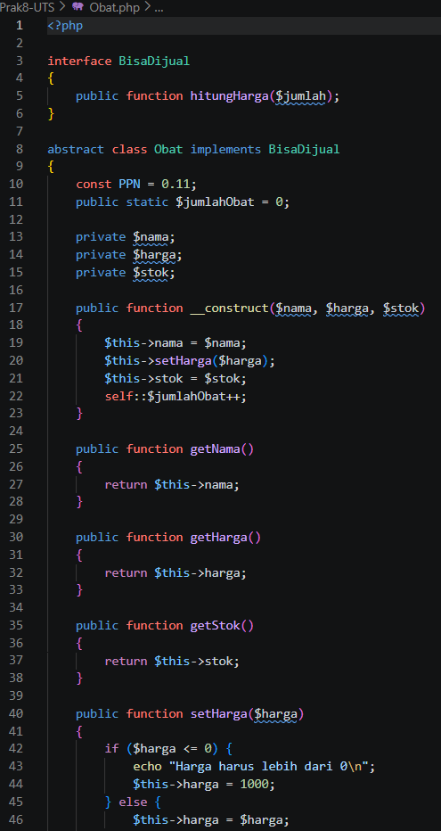
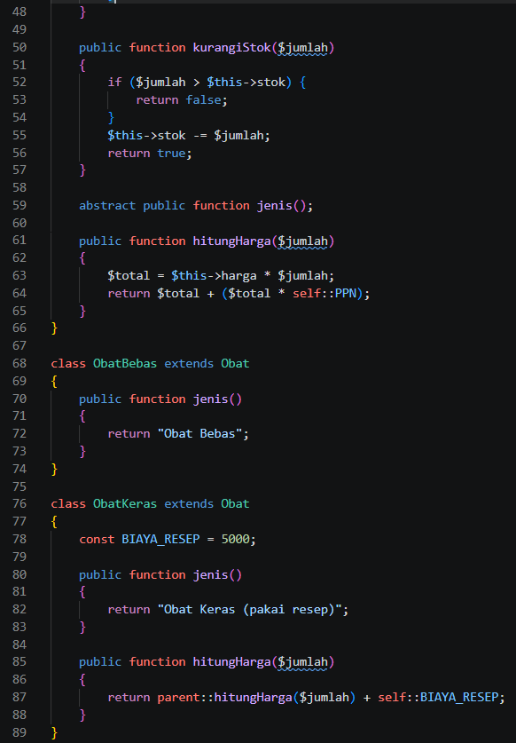
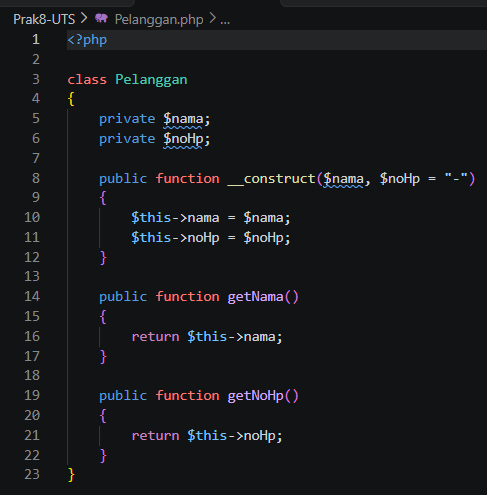
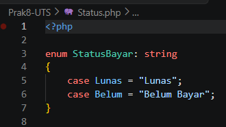
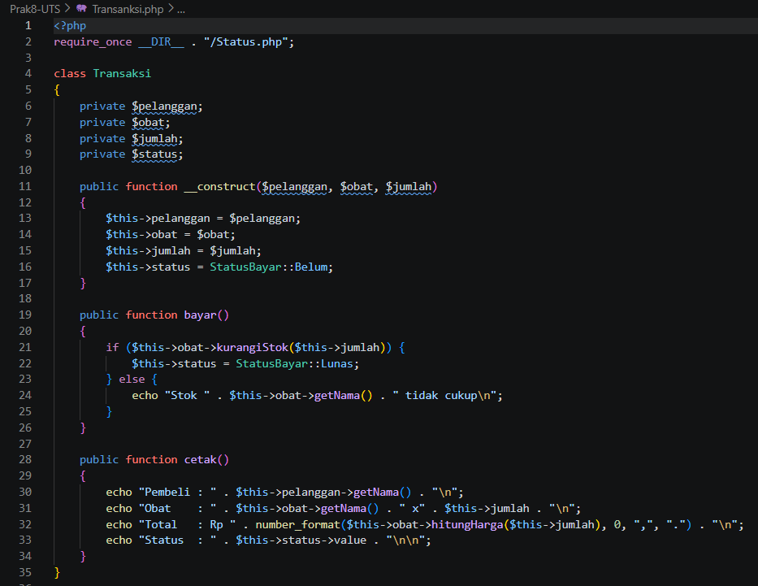
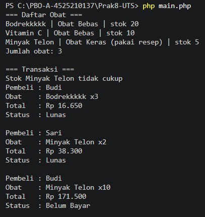

# Laporan UTS Praktikum PBO

## Identitas

| Keterangan | Data |
| --- | --- |
| Nama | **Arkan Abdul Hafizh** |
| NPM | **4525210137** |
| Mata kuliah | **Praktikum PBO-UTS** |

## Deskripsi Program

Program ini merupakan simulasi sederhana penjualan obat menggunakan PHP. Program
mengelola data obat, pelanggan, dan transaksi. Implementasinya memperlihatkan
konsep pemrograman berorientasi objek seperti interface, abstract class,
inheritance, encapsulation, static property, konstanta, enum, dan method
overriding.

## Struktur Folder

```text
Prak8-UTS/
├── images/
│   ├── MainPhp.png
│   ├── ObatPhp1.png
│   ├── ObatPhp2.png
│   ├── PelangganPhp.png
│   ├── RunPhp.png
│   ├── StatusPhp.png
│   └── TransaksiPhp.png
├── Main.php
├── Obat.php
├── Pelanggan.php
├── README.md
├── Status.php
└── Transanksi.php
```

## Struktur dan Penjelasan File

| File | Penjelasan |
| --- | --- |
| [`Main.php`](./Main.php) | Entry point program. Membuat objek obat dan pelanggan, menjalankan transaksi, lalu menampilkan daftar obat, ringkasan transaksi, dan stok akhir. |
| [`Obat.php`](./Obat.php) | Mendefinisikan interface `BisaDijual`, abstract class `Obat`, dan dua turunannya: `ObatBebas` serta `ObatKeras`. Perhitungan harga mencakup PPN 11%; obat keras menambahkan biaya resep. |
| [`Pelanggan.php`](./Pelanggan.php) | Mendefinisikan class `Pelanggan` dengan atribut nama dan nomor HP yang dienkapsulasi, serta constructor dengan nomor HP opsional. |
| [`Status.php`](./Status.php) | Mendefinisikan enum `StatusBayar` dengan status `Lunas` dan `Belum Bayar`. |
| [`Transanksi.php`](./Transanksi.php) | Mendefinisikan class `Transaksi`, yang memproses pembayaran dengan mengecek stok dan mencetak detail pembelian. Nama file dipertahankan sesuai berkas yang tersedia di proyek. |

## Konsep PBO yang Digunakan

- **Interface:** `BisaDijual` menetapkan method `hitungHarga()`.
- **Abstract class dan inheritance:** `Obat` menjadi kelas dasar bagi `ObatBebas` dan `ObatKeras`.
- **Encapsulation:** atribut pada class `Obat`, `Pelanggan`, dan `Transaksi` dibuat `private`; data obat/pelanggan dibaca melalui getter.
- **Polymorphism / overriding:** `ObatKeras` menimpa `hitungHarga()` untuk menambahkan biaya resep.
- **Static property dan konstanta:** `Obat::$jumlahObat`, konstanta `PPN`, dan `BIAYA_RESEP`.
- **Enum:** `StatusBayar` menjaga nilai status pembayaran tetap terdefinisi.

## Cara Menjalankan

Pastikan PHP versi **8.1 atau lebih baru** tersedia, lalu jalankan dari folder ini:

```bash
php Main.php
```

`Main.php` memuat file pendukung menggunakan path relatif terhadap file utama,
sehingga pemanggilan tetap merujuk ke berkas proyek yang benar.

## Dokumentasi Kode

### `Main.php`



### `Obat.php`




### `Pelanggan.php`



### `Status.php`



### `Transanksi.php`



## Hasil Program

Berikut tampilan hasil running program saat `php Main.php` dijalankan di terminal:



## Catatan Hasil

- Terdapat tiga objek obat, sehingga jumlah obat yang ditampilkan adalah `3`.
- Transaksi Budi untuk 3 unit obat pertama berhasil dengan total **Rp 16.650**.
- Transaksi Sari untuk 2 unit obat keras berhasil dengan total **Rp 38.300**.
- Pembelian 10 unit obat keras tidak berhasil karena stok yang tersedia hanya 3.
- Stok akhir objek obat keras tetap **3** setelah transaksi yang gagal.

> Catatan: nama objek obat keras pada kode adalah `Minyak Telon`; variabel di
> `Main.php` bernama `$amoxicillin`. Keluaran menggunakan nama objek yang
> ditampilkan, yaitu `Minyak Telon`.