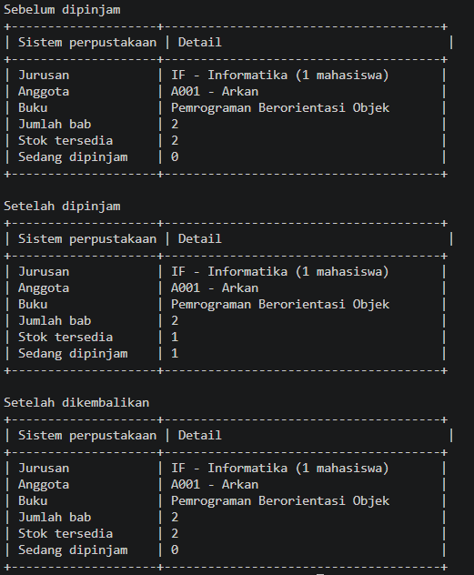
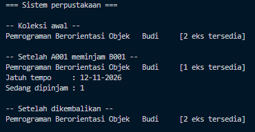

# LAPORAN PRAKTIKUM PEMROGRAMAN BERBASIS OBJEK

| Informasi Praktikan | Keterangan |
| :--- | :--- |
| **Nama** | Arkan Abdul Hafizh |
| **NPM** | 4525210137 |
| **Kelas** | A |
| **Mata Kuliah** | Pemrograman Berbasis Objek (PBO) |
| **Pertemuan** | 9 - Package, Namespace, dan Build Tool |
| **Tanggal** | 30-10-2026 |

---

## 1. Deskripsi Program

Program ini adalah Sistem Perpustakaan sederhana yang dikerjakan dalam dua bahasa. Kode direstrukturisasi menjadi proyek **Maven** (Java) dan proyek **Composer** (PHP) dengan penamaan package/namespace yang benar. Setiap proyek memakai satu dependensi eksternal: **Apache Commons Lang3** pada Java dan **Carbon** pada PHP.

Fitur program: menambah koleksi buku, mendaftarkan anggota, meminjam dan mengembalikan buku (dengan perhitungan tanggal jatuh tempo), serta penanganan error saat buku tidak ditemukan.

---

## 2. Struktur Folder

```
Prak9/
├── images/
│   ├── RunJava.png
│   └── RunPhp.png
├── README.md
└── starter/
    ├── .gitignore
    ├── java/
    │   ├── pom.xml
    │   ├── src/
    │   │   ├── main/
    │   │   │   ├── java/                        <- kode program
    │   │   │   │   └── id/ac/univpancasila/perpustakaan/
    │   │   │   │       ├── App.java
    │   │   │   │       ├── model/
    │   │   │   │       │   ├── Anggota.java
    │   │   │   │       │   ├── Buku.java
    │   │   │   │       │   └── Jurusan.java
    │   │   │   │       ├── service/
    │   │   │   │       │   └── PerpustakaanService.java
    │   │   │   │       └── util/
    │   │   │   │           └── Format.java
    │   │   │   └── resources/                   <- berkas konfigurasi
    │   │   └── test/
    │   │       └── java/                        <- kode pengujian (dipakai sesi 11)
    │   └── target/                              <- HASIL kompilasi, JANGAN di-commit
    └── php/
        ├── composer.json
        ├── composer.lock                        <- WAJIB di-commit
        ├── main.php                             <- titik masuk
        ├── src/
        │   ├── Model/
        │   │   ├── Anggota.php
        │   │   ├── Buku.php
        │   │   └── Peminjaman.php
        │   ├── Service/
        │   │   └── PerpustakaanService.php
        │   └── Util/
        │       └── Format.php
        ├── tests/
        └── vendor/                              <- hasil composer install, JANGAN di-commit
```

---

## 3. Implementasi Java (Maven)

Nama package sama persis dengan jalur foldernya, yaitu `id.ac.univpancasila.perpustakaan`. Baris `package` di awal setiap berkas menunjukkan lokasi berkas tersebut.

### 3.1. File: `pom.xml`
**Penjelasan Kode:**

`pom.xml` adalah berkas konfigurasi Maven. Di dalamnya didefinisikan identitas proyek (`groupId` = `id.ac.univpancasila.perpustakaan`, `artifactId` = `perpustakaan`, `version` = `1.0.0`), versi Java melalui `maven.compiler.release`, serta dependensi eksternal `commons-lang3` versi 3.17.0.

### 3.2. File: `App.java`
**Penjelasan Kode:**

`App` adalah titik masuk program (memiliki method `main`). Kelas ini membuat objek dari package `model`, memanggil `PerpustakaanService`, dan menampilkan hasilnya dengan bantuan `Format`.

### 3.3. Package `model`: `Buku.java`, `Anggota.java`, `Jurusan.java`
**Penjelasan Kode:**

Berisi kelas-kelas domain perpustakaan. `Buku` dan `Anggota` merepresentasikan data utama, sedangkan `Jurusan` adalah tipe pendukung untuk data anggota. Setiap berkas diawali `package id.ac.univpancasila.perpustakaan.model;`.

### 3.4. Package `service`: `PerpustakaanService.java`
**Penjelasan Kode:**

Berisi logika bisnis perpustakaan, dipisahkan dari `model` agar tanggung jawab tiap package jelas.

### 3.5. Package `util`: `Format.java`
**Penjelasan Kode:**

Kelas utilitas untuk merapikan tampilan tabel di terminal. Kelas ini memakai dependensi eksternal **Apache Commons Lang3** melalui `StringUtils` (`rightPad`, `capitalize`, `lowerCase`, `repeat`).

### 3.6. Dependensi Eksternal (Java)
**Penjelasan:**

Dependensi yang ditambahkan adalah `org.apache.commons:commons-lang3:3.17.0`. Dependensi ini benar-benar dipakai di `Format.java`, yang dipanggil dari `App.java`.

### 3.7. Cara Build dan Run (Java)

**Dengan Maven:**
```bash
cd starter/java
mvn clean compile
mvn exec:java -Dexec.mainClass=id.ac.univpancasila.perpustakaan.App
mvn dependency:tree > ../dependency-tree.txt
```

**Tanpa Maven (compile manual dengan JDK, Windows PowerShell):**
```powershell
cd starter\java
mkdir lib
Invoke-WebRequest -Uri "https://repo1.maven.org/maven2/org/apache/commons/commons-lang3/3.17.0/commons-lang3-3.17.0.jar" -OutFile "lib\commons-lang3-3.17.0.jar"
mkdir out
Get-ChildItem -Recurse src -Filter *.java | ForEach-Object { $_.FullName } | Out-File sources.txt -Encoding ascii
javac -cp "lib\*" -d out "@sources.txt"
java -cp "out;lib\*" id.ac.univpancasila.perpustakaan.App
```

> **Catatan:** error `UnsupportedClassVersionError` muncul bila versi Java saat compile (`maven.compiler.release`) lebih baru daripada versi `java` di terminal. Pada percobaan ini JDK di terminal adalah Java 21, sehingga proyek dikompilasi dengan target 21. Error `package org.apache.commons.lang3 does not exist` muncul bila `javac` dijalankan tanpa menyertakan jar dependensi (`-cp "lib\*"`).

---

## 4. Implementasi PHP (Composer + PSR-4)

Namespace dasar proyek adalah `Perpustakaan\`, dipetakan ke folder `src/` memakai autoload PSR-4. Nama folder harus sama persis (termasuk huruf besar-kecil) dengan namespace-nya.

### 4.1. File: `composer.json`
**Penjelasan Kode:**

`composer.json` berisi tiga hal utama:
- `require`: PHP minimal 8.2 dan dependensi `nesbot/carbon` versi `^3.0` (boleh naik ke 3.x terbaru, tetapi tidak ke 4.0).
- `autoload`: pemetaan PSR-4 `Perpustakaan\` ke folder `src/`.
- `autoload-dev`: pemetaan `Perpustakaan\Tests\` ke folder `tests/` untuk kode pengujian.

### 4.2. Namespace `Perpustakaan\Model`: `Buku.php`, `Anggota.php`, `Peminjaman.php`
**Penjelasan Kode:**

Berisi kelas-kelas domain perpustakaan. `Buku` menyimpan kode, judul, penulis, tahun, dan stok. `Anggota` menyimpan kode dan nama anggota. `Peminjaman` mencatat transaksi peminjaman, termasuk tanggal jatuh tempo yang dihitung memakai pustaka Carbon.

### 4.3. Namespace `Perpustakaan\Service`: `PerpustakaanService.php`
**Penjelasan Kode:**

Berisi logika bisnis perpustakaan: `tambahKoleksi`, `daftarkanAnggota`, `pinjam`, `kembalikan`, `getKoleksi`, dan `getPeminjamanAktif`. Method `pinjam` melempar `OutOfBoundsException` bila buku tidak ditemukan.

### 4.4. Namespace `Perpustakaan\Util`: `Format.php`
**Penjelasan Kode:**

Kelas utilitas dengan method `judul()` dan `kolom()` untuk merapikan tampilan keluaran di terminal.

### 4.5. File: `main.php`
**Penjelasan Kode:**

`main.php` hanya memuat satu baris `require __DIR__ . '/vendor/autoload.php'`. Seluruh `require_once` dihapus karena kelas dimuat otomatis oleh autoloader PSR-4 lewat pernyataan `use`. Alur programnya:

1. Membuat `PerpustakaanService`, menambah buku `B001`, dan mendaftarkan anggota `A001`.
2. Menampilkan koleksi awal.
3. Meminjam buku, lalu menampilkan koleksi, tanggal jatuh tempo (format `d-m-Y`), dan jumlah peminjaman aktif.
4. Mengembalikan buku, lalu menampilkan koleksi lagi.
5. Menguji error dengan meminjam buku `B999` yang tidak ada, lalu menangkap `OutOfBoundsException`.

### 4.6. Dependensi Eksternal (PHP)
**Penjelasan:**

Dependensi yang ditambahkan adalah `nesbot/carbon` melalui `composer require nesbot/carbon`. Perintah ini membentuk `composer.lock` yang mencatat versi pasti setiap paket. Tanggal jatuh tempo dihitung dengan Carbon, bukan aritmetika manual.

### 4.7. Cara Build dan Run (PHP)
```bash
cd starter/php
composer install
php main.php
```

---

## 5. Hasil Eksekusi Program

Berikut hasil eksekusi program di terminal untuk masing-masing bahasa.

### 5.1. Java (`App`)

**Perintah:**
```powershell
java -cp "out;lib\*" id.ac.univpancasila.perpustakaan.App
```

**Bukti Eksekusi (Screenshot):**

<p align="center">
  
</p>
<p align="center"><sub>Gambar 1. Keluaran program Java setelah proyek di-compile dengan <code>commons-lang3</code> pada classpath.</sub></p>

**Keterangan:** program berjalan dari package `id.ac.univpancasila.perpustakaan` tanpa error `ClassNotFoundException`, dan tampilan tabel dirapikan oleh `Format` yang memakai `StringUtils` dari Apache Commons Lang3. Ini membuktikan dependensi eksternal sudah terpasang dan terpakai.

### 5.2. PHP (`php main.php`)

**Perintah:**
```powershell
php main.php
```

**Bukti Eksekusi (Screenshot):**

<p align="center">
  
</p>
<p align="center"><sub>Gambar 2. Keluaran program PHP yang memuat kelas lewat autoload PSR-4.</sub></p>

**Keterangan:** program berjalan hanya dengan satu `require` ke `vendor/autoload.php`, tanpa `require_once`. Keluarannya memuat koleksi awal, koleksi setelah dipinjam, tanggal jatuh tempo (dihitung dengan Carbon), koleksi setelah dikembalikan, dan pesan `Gagal:` pada uji error buku `B999`.

---

## 6. Kebersihan Repositori

`.gitignore` memuat `target/` dan `vendor/` sehingga artefak build tidak ter-commit. Pengecekan dilakukan dengan `git status`.

- `target/` dan `vendor/` **tidak** di-commit karena merupakan hasil build/unduhan yang dapat dibuat ulang (`mvn compile` dan `composer install`).
- `composer.lock` **wajib** di-commit agar versi dependensi identik di setiap lingkungan, sehingga hasil build dapat direproduksi.

---

## 7. Kesimpulan

Pada praktikum ini, dipelajari konsep penting berikut:
1. **Package (Java)**: Nama package harus sama persis dengan jalur folder, sehingga baris pertama berkas sudah menunjukkan lokasinya.
2. **Maven**: Struktur baku `src/main/java` dan `pom.xml` mengelola build serta dependensi secara otomatis.
3. **Namespace dan PSR-4 (PHP)**: Composer memetakan namespace ke folder sehingga kelas dimuat otomatis tanpa `require_once`.
4. **Dependensi Eksternal**: `commons-lang3` (Java) dan `nesbot/carbon` (PHP) ditambahkan dan benar-benar dipakai.
5. **Pengelolaan Repositori**: `target/` dan `vendor/` tidak di-commit, sedangkan `composer.lock` wajib di-commit demi versi yang konsisten.